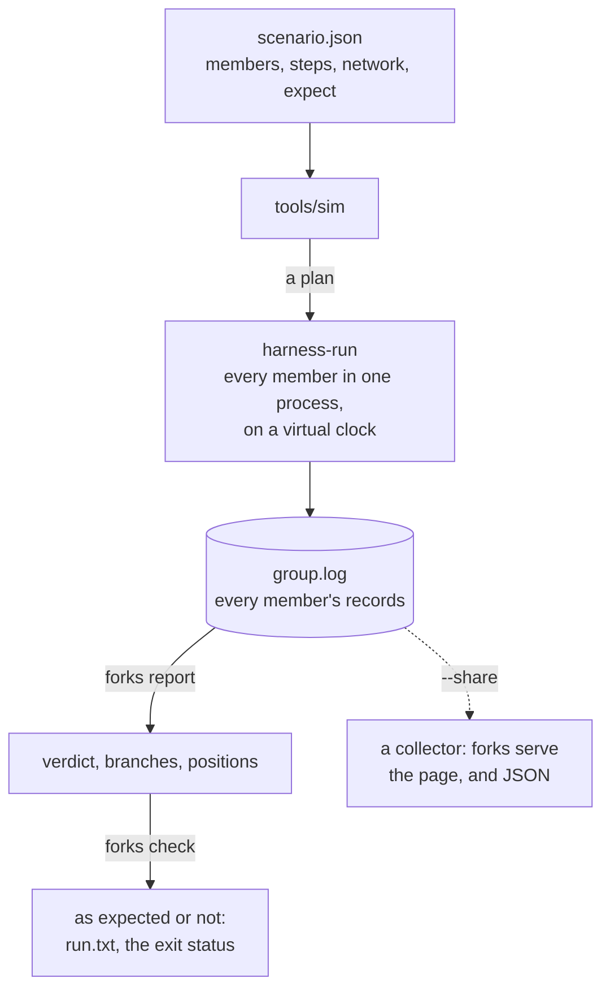
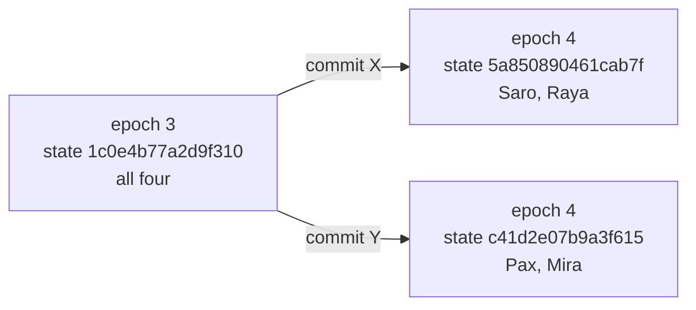
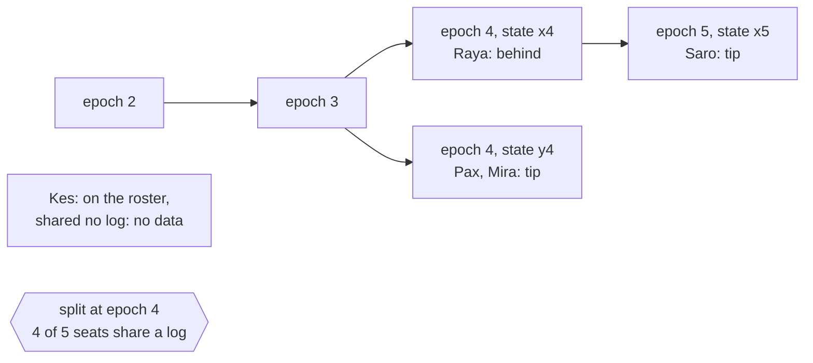
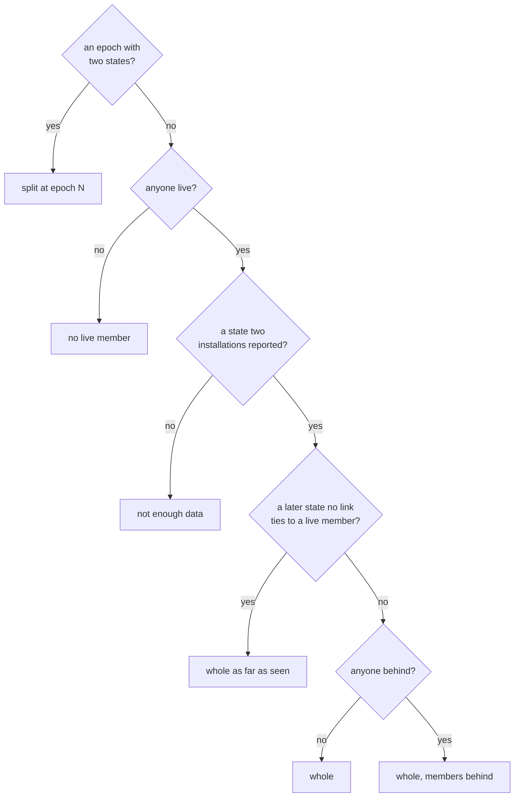

A GroupV2 conversation moves from epoch to epoch as its members apply commits. When two members apply
different commits at the same epoch the group forks: each side goes on, and neither can read what the
other sends. No member can see that from where it stands. It takes several members' states side by
side, and a simulation has every member's.



## A run in one process

`tools/sim` writes the scenario as a plan for `harness-run`, the runner of `crates/harness`. Every
member is a logos-chat client in that one process, at the revision chat-sim pins. Between each member
and what it receives stands the network model the scenario gives (`crates/network-model`): it loses a
share of the frames and holds the rest for a delay. The runner moves a virtual clock 50 ms at a time and
waits for nothing, so fifty epochs on the library's own timers, an hour on the clock, take under half a
minute.

Each member's chat core writes its records into `group.log`. `tools/sim` has `forks report` read the log
and `forks check` hold the report against what the scenario expects, and exits 0 only when every step
was done and the report is as expected. [Simulations](../simulations/) covers scenarios and sweeps.

## A state, not an epoch number



Both sides reach epoch 4. The number says nothing about which group a member holds, so every record of an
epoch carries a **state**: 8 bytes of a BLAKE2b hash of the MLS epoch authenticator.

- **Same commits, same state.** Every member of an epoch derives the same epoch authenticator, and members
  that applied different commits derive different ones. A fork shows as two states at one epoch.
- **Hashed, because the authenticator is a secret.** The record carries the hash, never the authenticator.
- **Short ids.** An installation is the first 4 bytes of its public signing key (`f95e254c`), an account the
  first 4 bytes of its id. A post is named by a hash of its frame, the same at the sender and every reader.

## What each member writes

The chat core writes one line per event on the log target `libchat::mls_trace`, at `trace`, in the span of
the GroupV2 or GroupV3 op that wrote it: the span names the member's signing key and the conversation. A
line of a run of `three.json`, where Saro's wakeup took the group from epoch 0 to 1:

```text
2026-01-01T00:00:00.500000Z TRACE groupv2.wakeup{user_id=saro signer=f95e254c convo=f190ef36ae epoch=0}: libchat::mls_trace: epoch epoch=1 state=d7dfaece05f67d08 members=3 signers=f95e254c:7361726f,671cc18a:72617961,c1f311f2:706178
```

`run`, `epoch` and `left` decide the verdict. `sent`, `received` and `unreadable` add what the page draws:
what became of each post. The records carry ids, epochs, states and times, and no message text.
[Records](../reference/records/) lists every field.

## How the logs reach one place

| From | How |
|---|---|
| a run of `tools/sim` | it hands the log to `forks report` and `forks check` itself; `--share ADDRESS` also sends it to a collector |
| a terminal | `forks share --to ADDRESS DIR` sends a directory of logs, and on the next go only what they gained |
| files in hand | `forks report FILES` reads them with no collector |

The **share address** is the collector's address with its token. Whoever holds it can send logs and read
every report. Writes are append-only by offset, so a sender that restarts goes on where the collector
stopped and nothing arrives twice.

## The rule



1. **Links make lines.** Two `epoch` records one installation wrote one after the other, in one run, the
   second at a later epoch, are a link: the second state came from the first. A `run` record or a leave
   breaks the chain.
2. **Two states at one epoch is a split.** The states after it group into branches along their links. The
   branch with more installations is `A`. The letter says nothing about which side is right.
3. **Every seat gets a position.** A seat is an installation that wrote in the conversation or that a roster
   lists. `tip`, `behind` and `lineage unknown` are live. `removed`, `ended`, `never joined` and `no data`
   are not. [Read the report](../read-the-report/) defines each one.
4. **The conversation gets one verdict,** the first that holds:



Only `whole` is a clean bill. Under every verdict a coverage line says how many seats shared a log: the
fewer, the less a `whole` is worth.

## What it does not do

- **It sees only what is shared.** One member's log alone cannot show a split. A run in one process
  writes every member into one log, so every seat shares one.
- **It reports and does not repair.** Nothing here changes how a group behaves.
- **The share address is the trust boundary.** The collector keeps each log whole, as sent.
