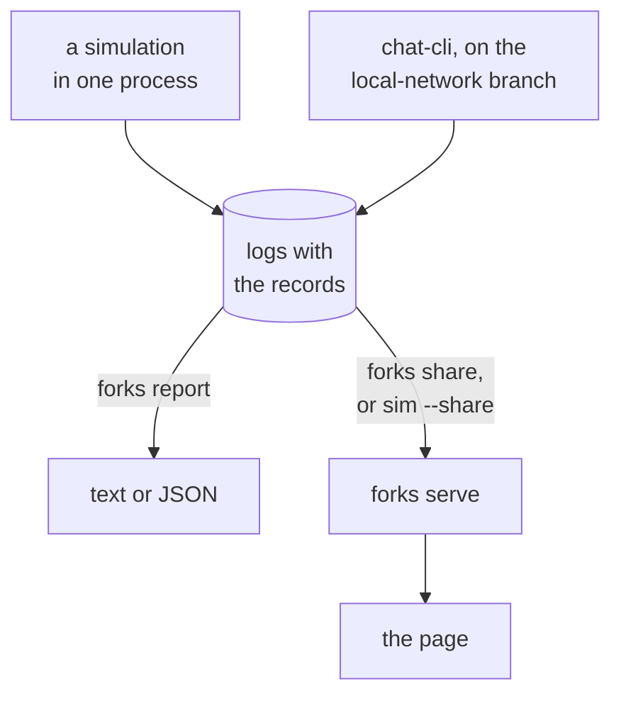

Every command runs from the root of a chat-sim checkout.



| To | You need |
|---|---|
| run a simulation | Nix; or Rust stable, the build tools `nix develop` provides (`protoc`, CMake, Perl, pkg-config) and Python 3.9 or newer |
| read logs, run the collector | Python 3.9 or newer; `tools/forks` and `tools/sim` use the standard library alone |

## 1. Get logs that hold the records

The records are `trace` lines on the target `libchat::mls_trace`. Every source below lets them through.

**A simulation.** Every member runs in one process on a virtual clock, on Linux the same run every time,
and writes into `group.log`:

```sh
nix run .#groupv2-simulation -- run tools/sim/scenarios/three.json --out tmp/three
```

Without Nix, build the runner and give it to `tools/sim`:

```sh
cargo build --release -p harness --bin harness-run
python3 tools/sim run tools/sim/scenarios/three.json --one-process target/release/harness-run --out tmp/three
```

[Simulations](../simulations/) covers scenarios and sweeps.

**chat-cli.** chat-cli writes the records into the log `--log-file` names, unless `RUST_LOG` sets another
filter. It builds on logos-chat changes that the revision chat-sim pins does not hold, so it lives on the
[`local-network`](https://github.com/logos-messaging/chat-sim/tree/local-network) branch, and `tools/sim`
runs one for each member with `--chat-cli` (see
[Simulations](../simulations/#chat-cli-and-the-local-network-branch)).

`forks` also reads the log file of logos-chat-module, which has a line shape of its own.

## 2. Read them

```sh
python3 tools/forks report tmp/three/group.log
```

```text
conversation f190ef36ae
  whole
  3 of 3 seats share a log

  branch A: epoch 1, state d7dfaece05f67d08, 3 members
    on it: 671cc18a, c1f311f2, f95e254c

  installation  account   name   epoch  position  branch
  671cc18a      72617961  group  1      tip       A
  c1f311f2      706178    group  1      tip       A
  f95e254c      7361726f  group  1      tip       A

lines: 10 read, 10 records, 0 without a stamp, 0 malformed, 0 unknown
```

A `PATH` is a log, or a directory, which stands for every `.log` file directly in it. Give each member's
log, or all of them in one directory. A run is named by its file name without `.log`, and the parts of a
run (`.001.log` and on) read as one. Two runs with one name are refused, even from two directories: read
them one directory at a time. `--json FILE` also writes the report as JSON.

| Exit | When |
|---|---|
| 0 | every conversation reads `whole` and no record was malformed |
| 1 | any other verdict, no conversation, or a malformed record |
| 2 | the command line is wrong, a log cannot be read, or the JSON cannot be written |

So `whole, members behind` exits 1. [Read the report](../read-the-report/) explains every line.

## 3. Collect them

The collector keeps the logs members send and serves the report as a page and as JSON.

```sh
python3 -c 'import secrets; print(secrets.token_urlsafe(24))' > forks-token
python3 tools/forks serve --data forks-data --token-file forks-token
```

It listens on `127.0.0.1:8750`. The **share address** is `http://127.0.0.1:8750/?token=` and the token.
Send a directory of logs to it:

```sh
python3 tools/forks share --to "http://127.0.0.1:8750/?token=$(cat forks-token)" \
  tmp/three
```

Open the share address in a browser: the collector sets a cookie and shows the page.

- **Sharing again sends only what is new.** `share` leaves its receipt in `.forks-share.json` in each
  directory it sent from.
- **Off this machine,** pass `--bind` an address the others reach. The collector speaks plain HTTP, so the
  token and the logs travel in the clear unless something in front of it adds TLS.
- **Whoever holds the share address** can send logs and read every report. A run the collector has not
  heard from for 30 days is deleted.

`python3 tools/sim run ... --share ADDRESS` sends a run's logs as its last step.

## Run the tests

```sh
cargo test --workspace
python3 -m unittest discover -s tools/forks
python3 -m unittest discover -s tools/sim
python3 -m unittest discover -s .github/scripts
```

`cargo test` needs what a build of the runner needs; CI runs it in the dev shell, on Linux and macOS. The
Python suites need Python alone: `tools/sim` is tested against stand-ins for chat-cli, the container
engine and the runner.
