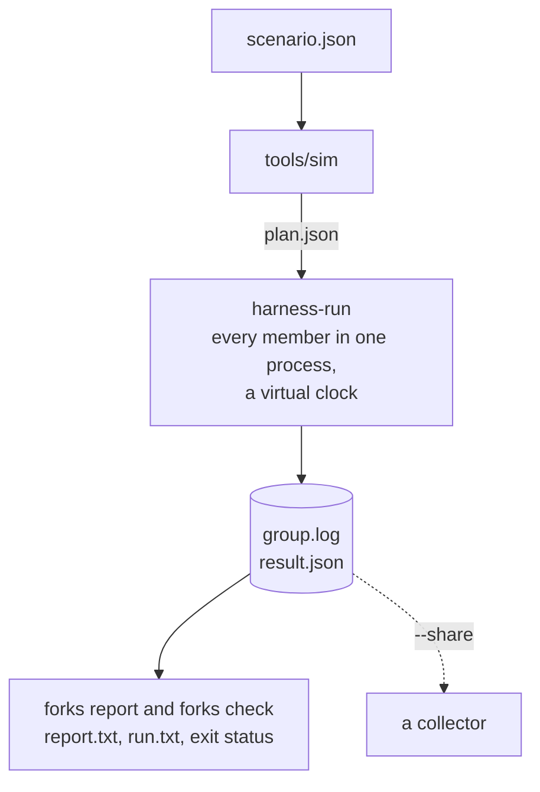

`tools/sim` runs a group the way a scenario file says. On master it runs every member in one process:
`harness-run` seats them in one group of logos-chat clients and does the steps on a virtual clock. On
Linux a scenario and its seed give the same run every time, which makes it the reference a change to
logos-chat is held to. `tools/sim` then has the fork report read the members' log, and holds the report
against what the scenario expects. It can also run a chat-cli process for each member, and chat-cli is
on the `local-network` branch (see [chat-cli and the local-network branch](#chat-cli-and-the-local-network-branch)).



## A first run

```sh
nix run .#groupv2-simulation -- run tools/sim/scenarios/three.json --out tmp/three
```

The flake's app `groupv2-simulation` builds `harness-run` from the checkout and runs `tools/sim` with it,
as `--one-process`; what follows `--` is the sim's command line. Without Nix:

```sh
cargo build --release -p harness --bin harness-run
python3 tools/sim run tools/sim/scenarios/three.json --one-process target/release/harness-run --out tmp/three
```

```text
3 members, fast group timers, one process, 0.600s on a virtual clock in 0.010s of wall time, seed 0
whole: 3 of 3 members at the tip
the report is as expected
load average 4.39 at the start, 4.39 at the end

member  installation  errors
saro        f95e254c       0
raya        671cc18a       0
pax         c1f311f2       0

batch  joiners  members  seated
1            2        3  0.500s

post  from  read by  median   worst
1      pax   2 of 2  0.000s  0.000s
```

- The head says how far the virtual clock went and how long that took, the seed, the verdict, how many
  members are at the tip, and whether the report is as expected. Every other time is on the clock.
- `member` is each member: its installation id, and how many frames it rejected (`errors`). When any
  member rejected one, an `inbound error` table follows: each error in the core's words, how many
  frames it was given for, and by how many members.
- `batch` is each `/add`: how many joined, the group's size after it, and the seconds from the first try of
  the add until every member waited on held the new roster.
- `post` is each post: how many read it, and how long they took.

`--out` must not exist. It holds `plan.json` (what the runner was given), `group.log` and `result.json`
(what it left), `runner.out` and `runner.stderr`, `report.txt` and `report.json` (the fork report),
`expect.json` (what the report was held to), `run.txt` (what was printed) and `run.json` (the same and
more, for scripts).

| Exit | When |
|---|---|
| 0 | every step was done and the report is as the scenario expects |
| 1 | a step was not done, or the report differs |
| 2 | the command line or the scenario is refused; nothing started |
| 128 + n | signal n interrupted it; the run is not checked |

A run is judged by the check, not by the report's own exit status: a scenario may expect a verdict other
than `whole`.

## A scenario

```json
{
  "members": 4,
  "budget": 33,
  "network": {"seed": 1, "loss": 0.02, "delay_ms": 40},
  "steps": [
    {"step": "seat", "to": 4, "batch": 2},
    {"step": "post", "from": "all"}
  ]
}
```

Members are named `saro`, `raya`, `pax`, `mira`, `kes`, `tomo`, then `peer7` on. `saro` creates the
group. This one, saved as `four.json`, seats the others two at a time, has every member lose 2% of the
frames it receives and hold the rest for 40 ms, and has every member post:

```text
4 members, fast group timers, one process, 1.750s on a virtual clock in 0.016s of wall time, seed 0, network seed 1, loss 0.02, welcome loss 0
whole: 4 of 4 members at the tip
the report is as expected
load average 3.05 at the start, 3.05 at the end

member  installation  arrived  passed  held  lost  errors
saro        f95e254c       12      11     0     1       0
raya        671cc18a       13      13     0     0       0
pax         c1f311f2       13      12     0     1       0
mira        97bfa122        4       4     0     0       0

batch  joiners  members  seated
1            2        3  0.550s
2            1        4  0.700s

post  from  read by  median   worst
1     saro   3 of 3  0.050s  0.050s
2     raya   3 of 3  0.050s  0.050s
3      pax   3 of 3  0.050s  0.050s
4     mira   3 of 3  0.050s  0.050s
```

With `network`, each member receives through a model of a lossy network: the `member` table counts the
frames that `arrived` at its model and those the model `passed`, `held` at the end and `lost`. A frame
the model loses never comes to its member later, so a wait that a lost frame leaves open runs to the end
of its `budget`, which is why `four.json` sets 33 s in place of 180.

| Field | Default | Holds |
|---|---|---|
| `members` | | how many members start |
| `steps` | | what they do, in order |
| `group` | `v2` | `v2`, or `v3` for a GroupV3 group, which is run in one process alone, removes no member, has no commit candidate, cannot be cut and keeps no `timers` |
| `timers` | `fast` | `fast`, `default` (the library's own), or durations in ms over the default set |
| `budget` | `180` | seconds of the clock the waits of one batch, or of one post, may take |
| `seed` | `0` | what a run in one process draws every random number from |
| `network` | none | `seed`, `loss`, `welcome_loss`, `delay_ms` (one number, or by name) |
| `expect` | a whole group | how the outcome differs: `verdict`, `positions` by name, `posts` by name |
| `max_message_kib` | `512` | the largest message a node takes; nothing in one process applies it |
| `wire`, `preset` | none | a wire for a run in containers, and a fleet to join; refused in one process |

| Step | Does |
|---|---|
| `seat` `to` `batch` | saro adds members, `batch` at a time (10 by default), until the group holds `to` |
| `post` `from` | a member posts (`last` seated by default, a name, or `all`), and the others wait for it |
| `hold` `seconds` | nothing, for a while |
| `cut` `between`, `heal` | cut two sides off from each other, and end the cut; need `network` |
| `withhold` `from` | the member loses the next commit candidate to reach it, and `expect` says under `applied` the outcome when the group applied that candidate; needs `network` |
| `grow` `epochs`, `adders` or `by`, `branches`, `size` | members add members in rounds, on whatever branch each is on; the scenario's only step, in one process alone (see [A group that grows](#a-group-that-grows)) |

Every field is checked before anything starts. The full format, with every field and step, is in
[`tools/sim/README.md`](https://github.com/logos-messaging/chat-sim/blob/master/tools/sim/README.md).

## Scenarios to start from

| Scenario | Does |
|---|---|
| `three.json` | 3 members in one batch, one post |
| `twenty.json` | 20 members in two batches of 10, one post |
| `50-epochs.json` | 51 members one at a time, fifty epochs, on the library's own timers, as logos-chat-module runs a group; CI runs it |
| `50-epochs-waku.json` | the same, each member's frames held for a delay Waku relay was measured at; CI runs it |
| `50-epochs-waku-loss.json` | the same, with 5% of each member's frames lost, a rate assumed |
| `50-epochs-by-saro-waku-loss-*.json` | 51 members on the network of `50-epochs-waku-loss.json`, saro alone adding one a round toward epoch 50 with no cap on branches, at a loss of 0, 0.1, 1 or 5% that the name gives in percent; CI sweeps each |
| `lossy.json` | 5 members one at a time, with 5% of frames lost |
| `lost-candidate.json` | 5 members one at a time, pax losing a commit candidate of the round that seats the fifth |
| `grow-waku-loss-*.json` | 200 members on the library's own timers and Waku's delays, any member adding up to three a round, at a loss of 0 to 10% that the name gives in percent; CI sweeps 0, 0.1, 0.5, 1 and 5 |
| `grow-by-saro-waku-loss-*.json` | the same from 0.01 to 10%, saro alone adding |
| `grow-waku-size-50.json` | a group held at fifty members toward epoch 1000, at no loss; CI sweeps it |
| `*-groupv3.json` | each `50-epochs-by-saro-waku-loss-` and `grow-waku-loss-` scenario that CI sweeps, on a GroupV3 group; CI sweeps each as many times as its GroupV2 one |
| `fifty-sized.json` | 50 members ten at a time, with timers sized for fifty peers on one machine |
| `lossy-wire.json`, `fleet-five.json` | a wire and a fleet, for the rigs that run chat-cli (see [chat-cli and the local-network branch](#chat-cli-and-the-local-network-branch)) |

## Sweeps

`sweep` does a scenario `--runs K` times and prints a row as each ends. Run k takes the seed
`seed + k - 1`, and so it does with the seed of `network`. The row names each seed: `seed`, and
`network seed`.

```sh
nix run .#groupv2-simulation -- sweep four.json --runs 5 --out tmp/four-sweep
```

```text
run  seconds  at the tip  verdict                 check (one process: seconds of its virtual clock)
  1      1.8      4 of 4  whole                   as expected; seed 0; network seed 1
  2      1.8      4 of 4  whole                   as expected; seed 1; network seed 2
  3     33.6      3 of 4  whole, members behind   verdict: whole, members behind, expected whole, and 5 more; stopped: the roster of 4 members was not held within the budget by: raya; seed 2; network seed 3
  4      1.8      4 of 4  whole                   as expected; seed 3; network seed 4
  5      1.8      4 of 4  whole                   as expected; seed 4; network seed 5
4 of 5 runs went as expected
```

In run 3 Raya's model lost two frames, and Raya stayed at epoch 1: it never held the roster that seats
Mira. A run that went otherwise names its first difference from the expectation in the `check` column,
and what stopped the steps. Each run keeps its own directory under `--out`, and `sweep.txt` and `sweep.json` hold
the rows.

## Held to what is expected

```sh
nix run .#groupv2-simulation -- sweep tools/sim/scenarios/grow-waku-loss-5.json --runs 3 --out tmp/grow-waku-loss-5
python3 tools/sim compare tools/sim/expected/grow-waku-loss-5.json tmp/grow-waku-loss-5
```

```text
run  seed  change     verdict                 at the tip  seconds  came to
  1     0  same       split at epoch 3          31 of 38   2583.7  5 main branches ran side by side: trunk at epoch 12, 5 main, 7 sub, 7 fell behind, 4 behind at the end, 3 never joined
  2     1  same       split at epoch 5          26 of 30   2125.9  6 main branches ran side by side: trunk at epoch 14, 6 main, 2 sub, 7 fell behind, 2 behind at the end, 2 never joined
  3     2  same       split at epoch 5          13 of 20   1626.6  5 main branches ran side by side: trunk at epoch 11, 5 main, 0 sub, 6 fell behind, 4 behind at the end, 3 never joined
3 of 3 runs came out as expected
```

A run in one process is the same run every time from its seeds, on Linux, so a run that comes out other
than it did was changed by a revision of logos-chat or of chat-sim. `compare` holds each run of a sweep
in one process to the outcome a file expects of it: the seeds, the ids of the group and of its members,
the verdict, the members at the tip, the seconds of the clock, how the run came out and what stopped its
steps, and of a `grow` step the trunk's epoch, how the step ended (`whole`, `behind`, `split`, or
`stalled` where the trunk stopped short of the epoch it grew toward), the lines off the trunk, and the
members off it: behind at the end, on another line, or never joined. A run that came out otherwise has
the outcome expected under it, as `was`, and its change says where the run stands against it.

A run of a `grow` step stands, highest first, by the epochs without a fork (the first split's epoch, or
the trunk's where there is none); at the same epochs, whole at the end over any other ending; then the
fewer lines off the trunk; then the fewer members off it. Any other run stands by its verdict: a split,
the later the better, then any other verdict, then whole, and at each the more members at the tip. A run
with no verdict stands lowest.

| Change | Means |
|---|---|
| `same` | the outcome is the one expected |
| `better` | the run stands higher than the one expected |
| `worse` | the run stands lower |
| `re-rolled` | both runs drew ids, and the run drew others than the one expected, the group's or the members' (a run that read no result drew none and is `worse`): the ids follow from the seed, so the run is another run of that seed and says nothing of the group against the one expected, neither better nor worse |
| `changed` | neither: the run stands where the one expected did, in an outcome that differs all the same, such as in the seconds of its clock |

`compare` exits 0 when every run came out as expected and the sweep has a run for each outcome expected,
1 when not, and 2 when the sweep or the file cannot be read, the file holds outcomes without the ids and
the fields of a `grow` step, or a run was not in one process. It runs with `python3`: the flake's app
adds `--one-process`, which `compare` does not take.

`tools/sim/expected/` holds the outcomes of the scenarios CI sweeps at the revision of logos-chat that
`Cargo.toml` pins, and CI sweeps each as many runs as its file holds, from seed 0: two of each
`50-epochs-by-saro-waku-loss-` file, three of each `grow-waku-` one. `compare --write` writes a sweep's
outcomes to the file instead: a change that moves how a run comes out has its outcomes written, and the
file's diff shows the change.

The four `50-epochs-by-saro-waku-loss-` files measure how many epochs a group of 51 lasts as one group.
Each is `50-epochs-waku-loss.json` at no loss, 0.1%, 1% or 5% of the frames each member receives,
Welcomes too, with a `grow` step in place of its `seat` and `post` steps (see
[A group that grows](#a-group-that-grows)): saro alone adds, one member a round, toward epoch 50, and
`branches` is 51, one for each member, so that a run goes on past any split and the forks it counts are
those of fifty epochs. A lost Welcome costs the run one member, who never joined, where one stops a run
of `50-epochs-waku-loss.json` (see [With frames lost](#with-frames-lost)). At no loss a fork is the
code's, not the network's.

## A group that grows

A `grow` step has the runner add members in rounds. Each round draws one to `adders` members from the
`seed`, and each adds the next member at once, on whatever branch it is on; with `by` in place of
`adders`, that member alone adds, one a round. The states the members hold form lines: the creator's
first is on the trunk, and where a state has two after it, the one more members hold or have gone past
carries the line on and each other starts a branch. A branch off the trunk is a main branch, and one off any other branch a
sub-branch. The step ends when the trunk holds `epochs`, when the trunk and the main branches are
`branches` or more, when every member is seated, or when no member can be drawn. With `size`, an adder
whose add would take the group above it first removes the member seated longest ago.

A grow expects no outcome: how far the group gets before it parts is what it measures. Its run is not
checked and writes no `expect.json`, and it goes as expected when the runner did the step; `compare` is
what holds it to an outcome. After the tables `run.txt` says how the grow ended, what its rounds came to,
and each line. The end of the first run of the sweep above:

```text
5 main branches ran side by side: trunk at epoch 7, 5 main, 0 sub, 3 fell behind, 2 behind at the end, 0 never joined
10 rounds, 19 joiners, 0 of the adders refused a whole round, the longest 180.000s

line   kind  from  forked at  epoch  members
0     trunk     -          -      7        5
1      main     0          3      9       11
2      main     0          5      5        1
3      main     0          6      6        1
4      main     0          7      7        2
fell behind: mira at epoch 3, kes at epoch 6, peer17 at epoch 8
behind at the end: mira, peer17
```

A member falls behind when it comes out of a round holding a state another member has gone past, and is
behind at the end when it still does. `never joined` counts the members added that never held the group.

## One process, the same run every time

On Linux a scenario and its seeds give one run, whenever and wherever it is made. `harness-run` stands in
for libc's `getrandom`, with a generator seeded by the scenario's `seed`, and for `clock_gettime`, so that
its time of day is the virtual clock, which starts at 2026-01-01T00:00:00Z; and it runs openmls on one
thread. Every random number of the run, the ids of the group and its members among them, follows from the
seed, and which commit the group applies follows from the ids. The seed of `network` fixes what a member's
model does with the n-th frame to reach it. Two runs write the same `group.log` byte for byte, so a run
that changes between two revisions of logos-chat shows what the change did to the group, and nothing
else. Elsewhere, as on macOS, the ids come from the OS, and a batch's seconds can come out a step apart
from run to run.

What a network does that one process does not: a member answers a frame in the step it arrives, where
over a network the answers come over a second or two. That can make a run in one process take longer.
Of fifty members seated ten at a time on the library's own timers, the ten that the second batch seats
never vote on the steward election that batch opens, which is decided at its 30 s timeout, and the third
batch is seated after 90 s. Over a network the joiners vote within two seconds, and the batch is seated
after 73 to 75 s. How a joiner comes to vote on a proposal made before it joined is not traced. Seated
one at a time, as `50-epochs.json` seats them, no epoch takes longer than 70.05 s.

## In CI

| Job | Runs |
|---|---|
| Lint | that `flake.lock` and `Cargo.lock` pin one revision of logos-chat, `cargo fmt --check`, and `cargo clippy` with warnings as errors |
| Test | `cargo test --release --workspace` in the dev shell, on Linux and macOS |
| Tools | the tests of `tools/forks`, `tools/sim` and the script that writes the site |
| Sim in one process | `50-epochs.json` and `50-epochs-waku.json`, through `nix run .#groupv2-simulation` |
| List the scenarios held to what is expected | the names of the files in `tools/sim/expected/` and how many outcomes each holds, for the next job |
| Sim held to what is expected | for each file in `tools/sim/expected/`, a sweep of the scenario of that name, as many runs as the file holds outcomes, held by `compare` to the file |
| Publish the report to GitHub Pages | the report of the two simulation jobs, on the site |
| Measure main's tip when it has no point, and on Sundays run the long suite | every hour, in `measure-main.yml`: `simulate.yml`'s `main` suite at logos-chat main's tip, seeds 0 to 19 of each `50-epochs-by-saro-waku-loss-` scenario, unless the tip has its point on the site at the chat-sim commit a run measures, the newest that touches `crates/`, `Cargo.toml`, `Cargo.lock`, `.cargo/`, `rust-toolchain.toml`, `flake.nix`, `flake.lock`, `tools/forks/forks/`, `tools/sim/sim/` or `tools/sim/scenarios/`, a run of `main` at the tip handed no `pr` is queued or in progress, or one of chat-sim's default branch ended at that commit without its point; and once each Sunday, in UTC, its `long` suite at the tip, every scenario in `tools/sim/expected/` but the goal's and the two of fifty epochs, unless a run of `long` handed no `pr` was created that day, one is queued or in progress, or the tip has its long run on the site at that commit |

[Reports](../reports/) shows what the two simulation jobs came to on master and on each pull request.

## Fifty epochs as the module runs them

logos-chat-module sets no group timers, so a group in the app runs on the library's own: a member that
has not voted on a proposal within 10 s votes yes (`voting_delay`), a proposal is decided by its votes or
at 30 s (`consensus_timeout`), every steward makes a commit candidate 60 s after the first approved
proposal (`commit_batch_window`), and the candidates are gathered for up to 30 s before one is chosen
(`freeze_duration`).

A group splits at a commit or holds through it, and each commit opens an epoch, so what a run puts a group
through is its epochs: fifty members seated ten at a time are five. Two scenarios take a group through
fifty on these timers, saro adding the other fifty members one at a time, and then the last one posts:

- `50-epochs.json`, on a network that loses no frame and holds none;
- `50-epochs-waku.json`, on one that loses none and holds each frame a member receives for a delay Waku
  relay was measured at.

A third, `50-epochs-waku-loss.json`, loses 5% of the frames a member receives on top of Waku's delays, a
rate assumed for want of a measured one (see [With frames lost](#with-frames-lost)).

### The Waku network

The figures come from the simulation the Waku team published as `rln-delay-simulations` in
[waku-org/research](https://github.com/waku-org/research/tree/d7167bcedb1142e3d7462dcf24a30f65b1a3ef90/rln-delay-simulations)
([#42](https://github.com/waku-org/research/issues/42)):

| Of the simulation | |
|---|---|
| Nodes | 1000 `nwaku` nodes in Shadow, a mesh of 6 |
| Each link | 100 ms, which the team measured as the average of the live network; 83 Mbit/s down and 38 Mbit/s up |
| Packets lost | none: each of its 10 messages reached all 999 other nodes |
| RLN | 150 ms to make a proof, and 12 ms to check one at each node |
| Its 10 KB messages, less the first, as the team reads them | 8991 arrivals: 263 ms the fastest, 507.6 ms the mean, 518 ms the median, 627 ms 95 of 100, 673 ms the slowest |

`50-epochs-waku.json` gives the fifty-one members those arrivals' quantiles at the middles of 51 equal
slices, from 284 to 644 ms, and saro, which creates the group, the median;
[`tools/sim/README.md`](https://github.com/logos-messaging/chat-sim/blob/master/tools/sim/README.md#fifty-epochs-as-the-module-runs-them)
says which member has which. Two things it leaves out: no measured rate of loss on the live network was
found, so the model loses nothing, and a member's delay is the same for every frame it receives, where on
Waku it changes from sender to sender and from message to message.

### What they gave

An epoch is the seconds from the creator's add to every member holding the new roster; a post is the
seconds until each of the 50 others read it. The run CI makes, seed 0, at the revision chat-sim pins:

| Scenario | The clock at the end | Epoch 1 | Epochs 2 to 50 | Post, median and worst |
|---|---|---|---|---|
| `50-epochs.json` | 3494.75 s | 60.0 s | 70.0 to 70.05 s | 0 and 0 s |
| `50-epochs-waku.json` | 3627.34 s | 60.6 s | 71.75 to 72.95 s | 0.55 and 0.65 s |

Each took about 20 s of wall time on a machine of 16 cores.

- **Fifty epochs take an hour, and the timers are most of it.** An epoch after the first takes 70 s, the
  members' 10 s to vote and the 60 s window. The first, added while the creator is the group's only
  member, takes the window alone. Waku's delays add 0.6 to 2.95 s to an epoch, and put a post's reading
  at the reader's delay, to the next step of the clock.
- **A seed gives one run.** From seed to seed the ids of the group and its members change, and with them
  which commit the group applies. CI runs seed 0 of both on every push, and [Reports](../reports/) shows
  what they gave.

### With frames lost

A frame the model loses never comes to its member later, so a run of `50-epochs-waku-loss.json` stops at
the first epoch the group does not come through, and that epoch is what it measures.

```sh
nix run .#groupv2-simulation -- sweep tools/sim/scenarios/50-epochs-waku-loss.json --runs 10 --out tmp/50-epochs-waku-loss
```

Seeds 0 to 9, and network seeds 1 to 10, at the revision chat-sim pins:

| Seed | Outcome | Stopped in epoch | Frames lost |
|---|---|---|---|
| 0 | tomo never joined | 5 | 4 |
| 1 | `split at epoch 3`: mira and raya against saro and pax | 3 | 2 |
| 2 | saro, raya and pax never held the roster of three | 2 | 1 |
| 3 | raya behind | 2 | 2 |
| 4 | kes behind | 5 | 9 |
| 5 | `split at epoch 3`: raya alone on a branch | 3 | 1 |
| 6 | `split at epoch 6`: raya alone on a branch | 6 | 9 |
| 7 | mira behind | 12 | 94 |
| 8 | kes behind | 5 | 3 |
| 9 | `split at epoch 5`: kes alone on a branch | 5 | 8 |

No run got past epoch 12, and four of the ten split. One lost frame can end a run: seed 5 split with one
frame lost in all. On Linux a run of a seed is the same run whenever it is made, so each of these can be
traced.

## chat-cli and the local-network branch

`tools/sim` can also run a headless chat-cli process for each member, in place of the runner. chat-cli
builds on logos-chat changes that the revision chat-sim pins does not hold, so it lives on the
[`local-network`](https://github.com/logos-messaging/chat-sim/tree/local-network) branch, pinned to
logos-chat's `feat/local-network`, with the image a run in containers needs:

| Rig | Flag | Members | For |
|---|---|---|---|
| Local network | `--chat-cli PATH` | a chat-cli each, with a delivery node of its own on a network that holds the run's nodes and no other, and a mock registry | the real network stack, measured up to fifty members on one machine |
| Containers | `--image IMAGE` | the same, each in a container of its own, on a wire that delays, jitters and loses what it sends (`wire`) | the same over a lossy wire, on Linux or a Mac |
| Fleet | `--chat-cli PATH`, and `preset` in the scenario | chat-cli peers on `logos.test` | the public fleet; not reproducible |

That branch's flake adds the apps `groupv2-simulation-processes` and `groupv2-simulation-containers`
(Linux) beside `groupv2-simulation`, and its CI runs `three.json` over a local network, and `three.json`
and `lossy-wire.json` in containers. Over a network a seed does not make a run again: each chat-cli draws
its ids from the OS, and with them which commit applies.
[`tools/sim/README.md`](https://github.com/logos-messaging/chat-sim/blob/master/tools/sim/README.md)
covers each rig, what it needs and what it prints.
