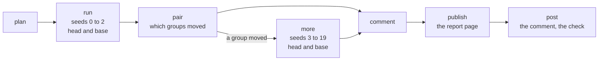

When a pull request to logos-chat opens or gets a push, logos-chat's workflow `chat-sim.yml`
starts chat-sim's `simulate.yml` at the pull request's head, against its merge base with `main`.
It queues a check named `chat-sim` on the head and writes a running line at the top of chat-sim's
comment. A pull request whose every changed file is under `docs/` or ends in `.md` gets its check
completed as skipped. A pull request from a fork gets nothing: its workflow is handed no secrets.

## What runs



The first stage runs seeds 0 to 2 of the goal, `grow-waku-loss-`, at 0.5, 1 and 5% loss, on GroupV2
and GroupV3: 18 runs at the head and the same 18 at the base, a job a run. Each job builds
`harness-run` with logos-chat pinned at its side's commit
([The scenarios](/chat-sim/guide/understand/scenarios/#the-goal)).

A group **moved** when one of its seeds has an outcome at both sides and the two differ in any
field. For each group that moved, the second stage runs seeds 3 to 19 of each of its rates at both
sides, six runs a job. A group where nothing moved stops at seed 2.

## The verdict

Each seed of a rate is a pair: the head's run and the base's. Its `d` is the head's epochs without a
fork less the base's ([How a run
works](/chat-sim/guide/understand/how-a-run-works/#what-a-run-comes-to)). A pair is **later** where
`d` is above 0, **earlier** where it is below, and **tied** where it is 0. A pair whose runs differ
at the same first fork counts on neither side.

Of a rate's `k` pairs later and `j` earlier, an exact two-sided sign test gives `p`: the chance of
a split at least that uneven if each pair were a coin toss. A rate's result is the first that holds:

| Result | When | Mark | The check |
|---|---|---|---|
| `unbuilt` | chat-sim does not build at the head | ⚫ | neutral, or a failure once required |
| `no-outcome` | a run at the head has no outcome | ⚫ | neutral, or a failure once required |
| `no-base` | no run at the base has an outcome | ⚫ | neutral |
| `same` | every pair with both outcomes came out the same | ⚪ | neutral |
| `earlier` | `p` is 1% or less, and more pairs are earlier | 🔴 | failure |
| `later` | `p` is 1% or less, and more pairs are later | 🟢 | success |
| `within` | the pairs moved, within chance | 🟡 | neutral |

A run at the base with no outcome leaves its pair out of the test. A group's result is the worst of
its rates, in the order unbuilt, no-outcome, earlier, later, within, no-base, same. The check fails
where a group's result fails it, else succeeds where one succeeds, so a group that forks later
cannot hide one that forks earlier. With chat-sim's repository variable `CHAT_SIM_CHECK_REQUIRED`
set to `true`, `unbuilt` and `no-outcome` fail the check.

Three seeds cannot reach 1%: three pairs of three earlier give `p` 0.25. That is why a group that
moved runs 17 seeds more. Of the pairs that moved, later or earlier, the test is beyond chance when
the fewer side holds at most:

| Pairs that moved | The fewer side |
|---|---|
| 0 to 7 | never beyond chance |
| 8 to 11 | 0 |
| 12 to 14 | 1 |
| 15 to 17 | 2 |
| 18 to 20 | 3 |

## The comment

The comment is chat-sim's one comment on the pull request, edited on every run. Where nothing
moved:

```text
⚪ Nothing moved. All 18 runs of GroupV2 and GroupV3 at 89abcde replayed its merge base fedcba9 exactly. The trees · the report, kept while the pull request is open · the graph over main · the run
```

Otherwise it has a line a group, then the links:

```text
⚪ GroupV2: nothing moved · 0.5%: nothing moved in seeds 0 to 2 · 1%: nothing moved in seeds 0 to 2 · 5%: nothing moved in seeds 0 to 2
🔴 GroupV3: forks earlier · 0.5%: nothing moved in seeds 0 to 19 · 1%: 0 later, 9 earlier, 11 tied (p 0.0039) · 5%: 2 later, 3 earlier, 15 tied (p 1)

The trees · the report, kept while the pull request is open · the graph over main · the run · 89abcde against its merge base fedcba9
```

`0 later, 9 earlier, 11 tied` counts the pairs of that rate. Where the base gave no outcome in
some of them, the rate adds `, no outcome at the base in 2 of 20 runs`. Where chat-sim does not
build at the head, the comment says so and that the build's errors are on the report page.

The check's title says each group's verdict in a few words:
`GroupV2 nothing moved in 9 runs; GroupV3 forks earlier at 1%: 0 later, 9 earlier (p 0.0039)`.
While the runs go it reads `18 runs in progress`. Its summary is the comment, and its details open
the report page.

## The report page

The comment links the pull request's report, `logos-chat/pr-N/` of the site.

| Part | Shows |
|---|---|
| The head | the head, its merge base and chat-sim's commit, and links to the pull request and the workflow run |
| The verdicts | a line a group, in the comment's words, with a chip in its result's colour |
| The scenarios | what the runs test, and how each scenario's grow runs, from the copies of the files the run kept |
| The trees | of each group, a row a rate and a column a seed of seeds 0 to 2: the head's tree over the base's, each linked to the run's page |
| The strips | under a rate that ran seeds 3 to 19, the `d` of each of its seeds from 0, linked to its run, and under them what the seeds came to |

A tree is one run, drawn from the lineage in its `run.json`, left to right by epoch from 0 to 50.
The top line is the trunk. Each line below left the line it drops from at that epoch and stops at
its dot. The thicker a line, the more members it ended with. A ring counts the members that never
joined. A run that moved is outlined. Hover a line for its numbers, or
open the run ([From a moved run to your machine](/chat-sim/guide/investigate/moved-run/)).

The report is kept while the pull request is open. When it closes, logos-chat's workflow has
chat-sim's Prune Pages remove `logos-chat/pr-N/`. A run still going then writes it again, and the
weekly run of Prune Pages removes every pull request's report that is not open.
