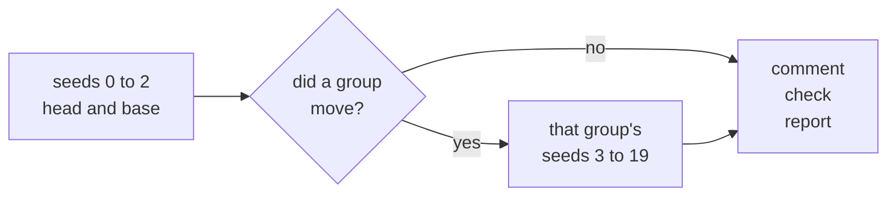

Every push to a logos-chat pull request runs chat-sim at two commits: the pull request's head,
and its merge base with `main`. chat-sim compares the two and tells you in three places:

- its one **comment** on the pull request, which it edits after each push
- a **check** named `chat-sim`, on the head commit
- a **report** page with every run, linked from the comment

## The comment

chat-sim simulates a group that grows, many times over, and compares when the group first
[forks](/chat-sim/guide/understand/how-a-run-works/#a-fork) at the head and at the base. Each
simulation is a **run**. The comment has one line for each kind of group, GroupV2 and GroupV3
([The two groups](/chat-sim/guide/understand/how-a-run-works/#the-two-groups)), then the links:

```text
⚪ GroupV2: nothing moved · 0.5%: nothing moved in seeds 0 to 2 · 1%: nothing moved in seeds 0 to 2 · 5%: nothing moved in seeds 0 to 2
🔴 GroupV3: forks earlier · 0.5%: nothing moved in seeds 0 to 19 · 1%: 0 later, 9 earlier, 11 tied (p 0.0039) · 5%: 2 later, 3 earlier, 15 tied (p 1)

The trees · the report, kept while the pull request is open · the graph over main · the run · 89abcde against its merge base fedcba9
```

The GroupV3 line reads:

- `🔴 GroupV3: forks earlier` is the group's **verdict** ([The verdict](#the-verdict)).
- `0.5%`, `1%` and `5%` are **rates of loss**: a member never receives that share of the frames
  sent to it. A **frame** is one message on the network, such as a commit or a vote.
- `seeds 0 to 19` name the runs of a rate, one run for each seed. A **seed** fixes every random
  choice of a run, so the head and the base run each seed under the same conditions. The two
  runs of a seed are a **pair**.
- `nothing moved in seeds 0 to 19`: all 20 pairs gave the same **outcome** at both sides. An
  outcome is what a run reports at its end
  ([A run's outcome](/chat-sim/guide/understand/how-a-run-works/#a-runs-outcome)). A run **moved**
  when its two sides gave different outcomes. GroupV3 ran 20 seeds, not 3, because one of its
  runs of seeds 0 to 2 moved ([What runs](#what-runs)).
- `0 later, 9 earlier, 11 tied`: in 9 pairs the head forked earlier than the base, in none later,
  and in 11 at the same epoch.
- `(p 0.0039)`: the chance that coin tosses would split the 9 pairs that are not tied so
  unevenly. It is under the threshold of 0.01, so at 1% loss the head forks earlier.
- `5%: 2 later, 3 earlier, 15 tied (p 1)`: in five pairs the two runs first forked at different
  epochs, and they lean neither way. A `p` of 1 is the highest there is. At 5% loss the runs
  moved within chance.

The rate of 1% loss gives the group its verdict, and [the check](#the-check) fails. The last
line links the trees, which draw the runs of seeds 0 to 2
([The report page](#the-report-page)), the report, the graph over main and, as `the run`, the
workflow run that made the runs.

When nothing moved in either group and every run was compared, the comment is one line:

```text
⚪ Nothing moved. All 18 runs of GroupV2 and GroupV3 at 89abcde replayed its merge base fedcba9 exactly. The trees · the report, kept while the pull request is open · the graph over main · the run
```

When the base gave no outcome in some runs, the rate adds `, no outcome at the base in 2 of 20
runs`. When chat-sim does not build at the head, the comment says so, and the report page has the
build's errors.

While a push's runs are going, a line at the top of the comment says so, above the last result.

## The verdict

Each kind of group gets one verdict. **Beyond chance** means that coin tosses would give so
uneven a result at most 1 time in 100 ([How it is reached](#how-it-is-reached)).

| Mark | Verdict | Meaning |
|---|---|---|
| ⚪ | nothing moved | every run with an outcome at both sides gave the same one at both |
| 🟡 | moved, within chance | some runs differ, and they lean neither earlier nor later beyond chance |
| 🔴 | forks earlier | the head forks earlier than the base, beyond chance |
| 🟢 | forks later | the head forks later than the base, beyond chance |
| ⚫ | does not build | chat-sim does not build against the head commit |
| ⚫ | no outcome | a run at the head gave no outcome |
| ⚫ | nothing to compare at the base | no run gave an outcome at the base |

A run gives no outcome when CI never made it, or when it ended without a result.

### How it is reached

A run is measured by its **epochs without a fork**: the epoch of its first fork, or the epoch
the group reached when it never forked. A pair is:

- **later** when the head went more epochs without a fork than the base
- **earlier** when it went fewer
- **tied** when it went as many

Each rate gets a verdict from its pairs, by an exact two-sided sign test. The test leaves the
tied pairs out. It asks how likely so uneven a split of later and earlier pairs is, if each pair
were a coin toss. That chance is `p`. A rate is beyond chance when `p` is 0.01 or less, and the
larger of its two counts then says which way: forks earlier, or forks later.

The test is there because a change can move a run by a side effect. One frame more, sent
anywhere, shifts which frames every member loses after it
([The same run, and when it is not](/chat-sim/guide/understand/how-a-run-works/#the-same-run-and-when-it-is-not)).
So the test asks whether the runs that moved lean one way.

Three seeds cannot reach 0.01: three earlier of three give a `p` of 0.25. So a group with a run
that moved runs 17 seeds more ([What runs](#what-runs)). Add up a rate's later and earlier pairs.
With 7 or fewer, the rate is never beyond chance. With more, it is beyond chance when the smaller
of the two counts is at most:

| Later and earlier pairs together | The smaller count is at most |
|---|---|
| 8 to 11 | 0 |
| 12 to 14 | 1 |
| 15 to 17 | 2 |
| 18 to 20 | 3 |

So 9 earlier and 0 later is beyond chance, and 9 earlier and 1 later is not.

Two more rules:

- Two runs can differ and still first fork at the same epoch. That pair is tied.
- A pair whose run at the base gave no outcome is left out of the test.

A group takes its verdict from its rates. It is the first of these that any of its rates has:

1. does not build
2. no outcome
3. forks earlier
4. forks later
5. moved, within chance
6. nothing to compare at the base
7. nothing moved

## The check

One check covers both groups:

- It fails when a group forks earlier.
- Otherwise it succeeds when a group forks later.
- Otherwise it is neutral, also when chat-sim does not build or a run gave no outcome.

So a group that forks later cannot hide one that forks earlier.

The check's title says each group's verdict in a few words, such as
`GroupV2 nothing moved in 9 runs; GroupV3 forks earlier at 1%: 0 later, 9 earlier (p 0.0039)`.
While the runs are going, it reads `18 runs in progress`, which counts the head's runs. Its
summary is the comment, and its details open the report page.

## What runs



A pull request runs [the goal](/chat-sim/guide/understand/scenarios/#the-goal). One member creates
a group, and its members add new ones from a supply of 200, toward epoch 50. The goal runs at
0.5, 1 and 5% loss, on GroupV2 and on GroupV3. Both sides run the same chat-sim, each
built with logos-chat at its own commit.

1. Seeds 0 to 2 run first: 18 runs at the head, and the same 18 at the base.
2. A run **moved** when it has an outcome at both sides, and the two outcomes differ in any
   field. A group moved when one of its runs did.
3. For each group that moved, seeds 3 to 19 run as well, at each of its rates and at both sides:
   51 more runs at each side. A group where nothing moved stops at seed 2.

Two kinds of pull request get no runs. One that changes only files under `docs/` or files ending
in `.md` has its check completed as skipped. One from a forked repository gets nothing, since its
workflow is handed no secrets.

## The report page

The comment links the pull request's report, `logos-chat/pr-N/` of chat-sim's site. Under the
verdicts, the page says what the scenarios test. Then come the runs:

- **The trees.** For each group, one row per rate and one column per seed, for seeds 0 to 2. Each
  cell holds the head's tree over the base's, and links the run's page.
- **The strips.** A rate that ran seeds 3 to 19 has a strip under its row. For each seed of the
  rate, it says how many epochs later or earlier the head first forked than the base, and links
  the run. Under the strip are the rate's words from the comment, and a fold that draws seeds 3
  to 19 as trees.

A tree is one run, drawn left to right by epoch, from 0 to 50:

- The top line is the trunk: the line that starts at the group's first state.
- Each line below is a branch. It drops from the line it left, at the epoch where it left, and
  runs on to its dot.
- The thicker a line, the more members it ended with.
- A ring counts the members that never joined.
- An outline marks a run that moved.

Hover a line for its numbers, or open the run ([From a moved run to your
machine](/chat-sim/guide/investigate/moved-run/)).

The report is kept while the pull request is open.
