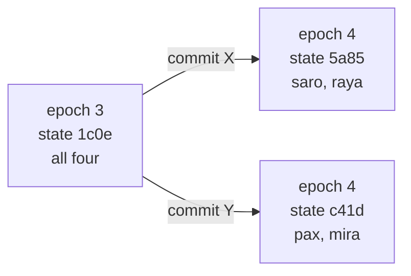
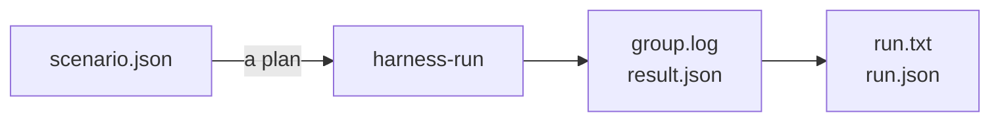

A run plays a scenario out on a group of logos-chat clients. The clients are logos-chat's own
code, built at one revision. Between them stands only a model of a network, which delays and
loses what each member receives. At the end, the run says whether the group is still one group,
and if not, at which epoch it forked.

## The two groups

A logos-chat group conversation is an MLS group. It moves from epoch to epoch as its members apply
commits, such as one that adds a member. chat-sim runs two of logos-chat's kinds of group:

- **GroupV2.** Members vote on each proposal, such as an add. The group's stewards then each
  offer a commit, a **commit candidate**, and one of the candidates is chosen.
- **GroupV3.** Any member commits. For each epoch, a member sets aside every commit it gets.
  120 s after the first, it applies the one with the lowest fingerprint.

A GroupV3 group can fork only when two members commit for one epoch. When several members add at
once, one of the adds is applied, and the members the others added never join
([logos-chat#352](https://github.com/logos-messaging/logos-chat/issues/352)).

## A fork

When two members apply different commits at the same epoch, the group forks. Each side goes on,
and neither can read what the other sends. No member can see that from where it stands, but a run
holds every member's state.

Both sides reach epoch 4, so the epoch number says nothing about which group a member holds. So
each member records a **state** every time its epoch moves: a fingerprint of the group at that
epoch. Members that applied the same commits hold the same state. Two states at one epoch is a
fork, counted at that epoch: epoch 4 in the picture. A state is 16 hex digits, cut to four
there.
[The records](/chat-sim/guide/reference/records/#the-records) lists what each member writes.

## One process, a virtual clock

`tools/sim` writes a plan from the scenario and hands it to `harness-run`, the runner, in
`crates/harness`. The runner runs every member in one process and does the plan's steps. It
leaves every member's log and what it measured, and from those `tools/sim` writes the run's
outcome.

What a member sends reaches the others as **frames**, such as a commit, a vote, a Welcome or a
post. Between each member and the frames sent to it stands the scenario's network model,
`crates/network-model`. It loses a share of the frames and holds the rest for a delay. A frame it
loses never comes later.

The clock is virtual: the runner moves it by at most 50 ms at a time and waits for nothing. So a
run takes the time its work takes, not the time its timers count. The run that
[What a run prints](/chat-sim/guide/investigate/moved-run/#what-a-run-prints) shows took 2712 s on
the clock and 21 s of wall time.

## A run's outcome

Most scenarios have one `grow` step: members add members in rounds, toward epoch 50
([A group that grows](/chat-sim/guide/understand/scenarios/#a-group-that-grows)). The runner
follows the states the members hold, and puts them on lines. The **trunk** starts at the
group's first state, and each fork starts a **branch**.

A run of a growing group reports:

| Part | Says |
|---|---|
| the first fork | the first epoch that holds two states, or none |
| the trunk's epoch | how far the trunk got |
| how it ended | `split`, `stalled`, `behind` or `whole` |
| off the trunk | the branches, and the members that are behind, on a branch or never joined |

How it ended is the first of these that is true:

- `split`: a branch started
- `stalled`: the trunk stopped short of the scenario's `epochs`
- `behind`: some members were behind at the end. A member is behind when other members have
  applied a commit that it has not.
- `whole`: none of the three

A run is measured by its **epochs without a fork**: the epoch of its first fork, or the epoch
its trunk reached when it never forked. The graph over main calls them the epochs before the
first fork. A pull request is judged by this number.

Fewer than 50 epochs without a fork is not always a fork. A run that ended `stalled` never
forked, and stopped short.

A run's **outcome** is all of the above, with its seeds, the ids of its group and members, how
many members were added, and the seconds of its clock. A run **moved** when its outcome differs
in any field from the outcome it is compared with.

A scenario without a `grow` step, such as `seat-50-post-groupv2.json`, reports another way.
`tools/forks` reads its log and gives the conversation a verdict, such as `whole` or
`split at epoch 4`
([Commands](/chat-sim/guide/reference/commands/#forks)).

## The same run, and when it is not

On Linux a scenario and its seeds always give the same run. A scenario has two seeds:

- The scenario's `seed` feeds every random draw of the members and the picks of a grow: the ids
  of the group and of its members among them. This is the seed the pages name.
- The `seed` of `network` fixes what a member's network model does with each frame, and nothing
  else.

The time comes from the virtual clock. So two runs of one scenario at one revision write the same
`group.log`, byte for byte. On macOS and other systems the ids come from the operating system,
and a run can differ from one time to the next.

So when a run moves between two revisions, something that differs between them moved it. That
need not be what the change set out to do. Two side effects move runs too:

- **One frame more shifts every later loss.** A member's network model decides each frame from
  its seed, the member's name and the frames shown to it so far. A change that sends one frame
  more, anywhere, shifts which frames each member loses after it.
- **One hash map more can move a run too.** Rust's standard library seeds each new `HashMap`
  from keys that it draws once, here from the run's seed, and counts up with every map built. So
  a change that builds one map more or fewer gives every map built after it another seed, and
  that can change a run's outcome.

That is why a pull request is judged over many seeds
([The verdict](/chat-sim/guide/track/pull-request/#the-verdict)).
