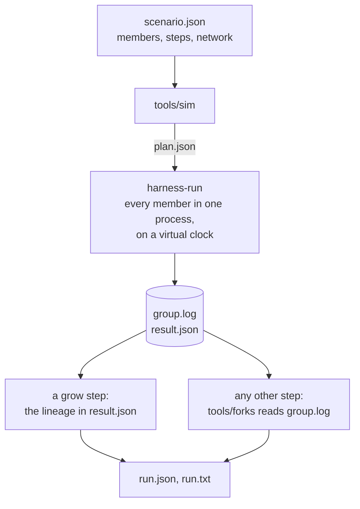
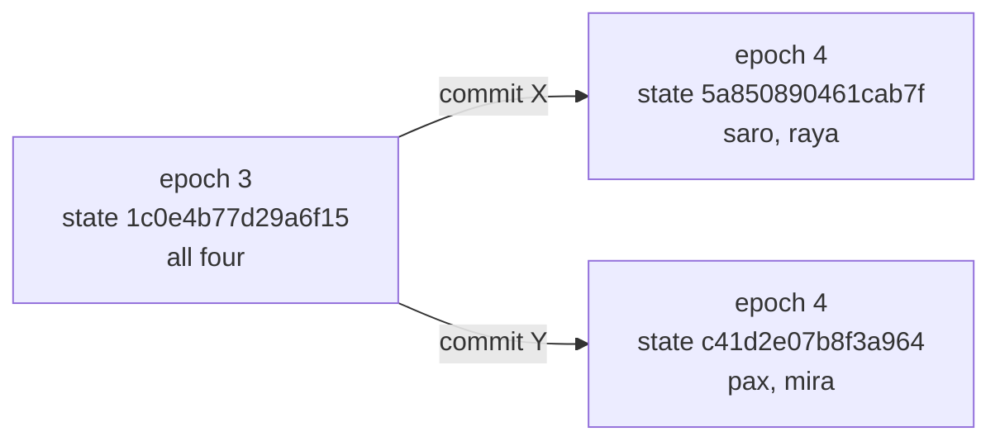

A run takes a scenario file and plays it out on a group of logos-chat clients. The clients are
logos-chat's own code, built at one revision. Nothing stands between them but a model of a network
that delays and loses what each member receives. At the end, the run says whether the group is
still one group, and if not, at which epoch it parted.

## The two groups

A logos-chat group conversation is an MLS group. It moves from epoch to epoch as its members apply
commits, such as one that adds a member. chat-sim runs both kinds of group logos-chat has.

- **GroupV2.** Members vote on each proposal, such as an add. Stewards then make commit candidates,
  and one of them is chosen. On the library's own timers, a member that has not voted within 10 s
  votes yes (`voting_delay`), and a proposal is decided by its votes or at 30 s
  (`consensus_timeout`). Every steward makes a candidate 60 s after the first approved proposal
  (`commit_batch_window`). The candidates are gathered for up to 30 s before one is chosen
  (`freeze_duration`).
- **GroupV3.** Any member commits. Of the commits deferred for one epoch, a member applies the one
  of the lowest fingerprint, 120 s after the first was deferred. A GroupV3 group removes no member
  and has no commit candidate.

A GroupV3 group can fork only where two members commit for one epoch. Of the adds of one round,
one is applied, and the members the others added never join
([logos-chat#352](https://github.com/logos-messaging/logos-chat/issues/352)).

## A fork

When two members apply different commits at the same epoch, the group forks. Each side goes on,
and neither can read what the other sends. No member can see that from where it stands, but a run
holds every member's state.

Both sides reach epoch 4, so the epoch number says nothing about which group a member holds. Each
member writes a record every time its epoch moves, with a **state**: 8 bytes of a hash of the
MLS epoch authenticator. Members that applied the same commits hold the same state, and members
that applied different ones hold different states. Two states at one epoch is a fork.
[Records](/chat-sim/guide/reference/records/) lists what each member writes.

## One process, a virtual clock

`tools/sim` writes the scenario as a plan for `harness-run`, the runner in `crates/harness`. The
runner seats every member in one process and does the steps. Between each member and what it
receives stands the scenario's network model, `crates/network-model`. It loses a share of the
frames and holds the rest for a delay. A frame it loses never comes later.

The runner moves a virtual clock 50 ms at a time and waits for nothing. So a run takes the time
its work takes, not the time its timers count. `50-epochs.json`, fifty epochs on the library's own
timers, is about an hour on the clock and takes under a minute.

## What a run comes to

Most scenarios have one `grow` step: members add members in rounds, on whatever branch each one
holds, toward epoch 50 ([A group that
grows](/chat-sim/guide/understand/scenarios/#a-group-that-grows)). The runner follows the states the
members hold as lines. The creator's first state is on the trunk. Where a state has two states after
it, the one more members hold carries the line on, and each other starts a branch. A grow run comes
to:

| Part | Says |
|---|---|
| the first fork | the lowest epoch a branch left at, or none |
| the trunk's epoch | how far the trunk got |
| how it ended | `split` where a branch left; else `stalled` where the trunk stopped short of its epochs; else `behind` where members were behind at the end; else `whole` |
| off the trunk | the lines off the trunk, and the members behind, on another line or never joined |

The **epochs without a fork** are the first fork's epoch, or the trunk's where the run never
forked. That is the number a pull request's runs are held to.

The two scenarios of fifty epochs seat members and post instead. Their log goes to `tools/forks`,
which reads every member's records and gives the conversation a verdict, such as `whole` or
`split at epoch 4`. `forks check` then holds that report to what the scenario expects.

## The same run, and when it is not

On Linux a scenario and its seeds give one run, whenever it is made. `harness-run` stands in for
libc's `getrandom` with a generator seeded by the scenario's `seed`. It stands in for
`clock_gettime` with the virtual clock, which starts at 2026-01-01T00:00:00Z. It runs openmls on
one thread. Every random number of the run follows from the seed, the ids of the group and its
members among them, and which commit the group applies follows from the ids. Two runs of one
scenario at one revision write the same `group.log` byte for byte.

So when a run comes out otherwise at two revisions, what differs between them moved it. That does
not make the move the change's doing alone:

- **One frame more re-deals the losses.** A member's network model decides each frame from the
  seed, the member's name and the frames shown to it so far. A change that sends one frame more,
  anywhere, shifts which frames each member loses after it.
- **One hash map more re-keys the others.** Rust's standard library seeds each new `HashMap` from
  keys drawn once per thread, and counts them up with every map built. A change that builds one
  map more or fewer can change how a run comes out.

That is why a pull request is judged over many seeds, by a test of how far its first forks moved
([Your pull request's result](/chat-sim/guide/track/pull-request/#the-verdict)). On macOS and other
systems the ids come from the operating system, and a run can differ from one time to the next.
